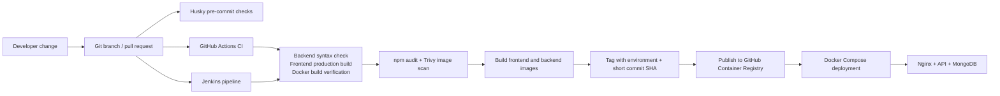

<div align="center">

# From Git Push to Running Containers

### A Jenkins + GitHub Actions CI/CD implementation for a containerized MERN application

**A hands-on DevOps project by an Associate DevOps Engineer**  
I built this project to practise the complete delivery path: validate code, build and scan container images, publish versioned artifacts, and deploy them with Docker Compose.

[](https://www.jenkins.io/)
[](https://github.com/features/actions)
[](https://www.docker.com/)
[](https://ghcr.io/)
[](https://www.mongodb.com/)

</div>

---

## The project

This repository combines a **MERN electronics storefront** with the delivery automation around it. The application has a React frontend, an Express/Node.js API, and MongoDB. Docker packages the services, while Nginx serves the production frontend and routes `/api` requests to the backend.

The focus is the engineering workflow: checks run before delivery, images are built and tagged with the environment and commit, and deployment configuration is kept separate from application source.

## Delivery flow



> GitHub Actions and Jenkins are both represented in this repository. The Jenkins stage view below is evidence of a successful Jenkins run; workflow triggers and configured secrets determine which automation path runs in a given setup.

### Branch and delivery behavior

| Branch / event | Automation represented in the repository |
|---|---|
| `feature/**`, `fix/**`, `hotfix/**` pushes | GitHub Actions CI: backend check, frontend build, and Docker image build verification |
| Pull requests targeting `main`, `staging`, or `qa` | GitHub Actions CI validation |
| `main`, `staging`, or `qa` pushes | GitHub Actions security workflow and image publish/deployment workflow; Jenkins pipeline also gates its deploy stages to these branches |
| Scheduled security run | GitHub Actions dependency and container scanning workflow |

## Pipeline stages

The Jenkins pipeline in [`Jenkinsfile`](Jenkinsfile) models the delivery lifecycle as visible stages:

1. **Checkout** the commit that triggered the job.
2. **Validate** backend syntax and build the frontend.
3. **Build** backend and frontend Docker images for verification.
4. **Audit and scan** dependencies and container images with npm audit and Trivy.
5. **Publish** versioned application images to GHCR.
6. **Deploy** the selected environment with Docker Compose on configured branches.
7. **Clean up** temporary images and registry authentication after the run.

The GitHub Actions workflows provide a second implementation of CI, security scanning, and image publishing/deployment. Their details live in [`.github/workflows`](.github/workflows).

## Proof of implementation


### Jenkins pipeline stage view

The second screenshot shows a successful run across checkout, backend and frontend checks, Docker verification, dependency audit, Trivy scan, GHCR publishing, deployment, and post actions.


## Why I implemented it

- **To close the gap between code and operations:** I wanted to understand what happens after a change is committed, through packaging and deployment.
- **To make delivery repeatable:** Pipeline stages and Docker Compose configuration turn a manual sequence into steps that can be reviewed and repeated.
- **To catch issues earlier:** Syntax/build checks and image verification run before publishing; dependency and image scans add security visibility to the workflow.
- **To practise environment-aware releases:** `qa`, `staging`, and `main` are mapped to environment-specific image tags and deployment paths.
- **To learn Jenkins in a practical setting:** The repository includes a separately configured, Dockerized Jenkins controller so I could explore the Jenkins pipeline while keeping its Compose project and persistent volume distinct from the application deployment.

## What I learned

- Structuring a **Jenkins declarative pipeline** with branch conditions, credentials, clear stages, and post-build cleanup.
- Building **Docker images for a React frontend and Node.js backend**, and using Nginx as a production static server and API reverse proxy.
- Using **Docker Compose networks, named volumes, service discovery, and environment variables** to connect application services.
- Publishing images to **GHCR** and using environment plus short commit SHA tags to identify a build.
- Adding **npm audit and Trivy** into CI so dependency and container findings are visible during delivery.
- Separating **CI validation, artifact publishing, and deployment configuration**, and documenting the secrets and environment values a deployment needs.
- Operating Jenkins in Docker with persistent data and resource limits, and recognizing that access to the host Docker socket gives jobs broad control of the host.
- Treating pipeline logs and stage results as operational evidence that helps locate a failure and communicate delivery status.

## Technology at a glance

| Area | Tools and implementation |
|---|---|
| Application | React, Vite, Node.js, Express, MongoDB, Mongoose |
| CI/CD | Jenkins Declarative Pipeline, GitHub Actions, Husky |
| Containers | Docker, Docker Compose, multi-stage frontend image |
| Web serving | Nginx, SPA fallback, `/api` reverse proxy, compression and response headers |
| Registry | GitHub Container Registry (GHCR) |
| Security and maintenance | Trivy, `npm audit`, Dependabot |
| Environments | `qa`, `staging`, `main` |

## Run the application locally

### Prerequisites

- Docker Engine and Docker Compose
- Or Node.js 20+ and a MongoDB instance for running services directly

### Start the containerized stack

```bash
docker compose up -d --build
```

The local Compose file maps the frontend to `http://localhost:5173` and the backend to port `5000`. MongoDB data is kept in a named Docker volume.

### Run frontend and backend separately

```bash
# Backend
cd backend
npm ci
npm run dev
```

```bash
# Frontend, in another terminal
cd frontend
npm ci
npm run dev
```

## Jenkins controller setup

An isolated Jenkins controller definition is included in [`docker-compose.jenkins.yml`](docker-compose.jenkins.yml) and [`Dockerfile.jenkins`](Dockerfile.jenkins). It uses a separate Compose project and persistent `jenkins_home` volume. The controller is configured with a 1 CPU and 2 GB memory limit; its UI is mapped to host port `8081` by default.

See the [isolated Jenkins setup guide](docs/JENKINS_ISOLATED_SETUP.md) for setup and lifecycle commands, and the [CI/CD guide](docs/CI_CD_GUIDE.md) for workflow and deployment configuration.

> **Operational note:** the Jenkins controller mounts the host Docker socket so trusted pipeline jobs can build and deploy containers. This grants those jobs significant access to the Docker host. Use trusted pipeline code and review the server security implications before enabling it.

## Repository map

```text
├── .github/workflows/       # GitHub Actions CI, security, and CD workflows
├── backend/                 # Express API and MongoDB integration
├── frontend/                # React application and Nginx configuration
├── docs/                    # CI/CD and isolated Jenkins setup guides
├── Dockerfile.jenkins       # Custom Jenkins image with Docker CLI
├── Jenkinsfile              # Jenkins CI, scan, publish, and deploy stages
├── docker-compose.yml       # Local application stack
├── docker-compose.deploy.yml # Image-based deployment stack
└── docker-compose.jenkins.yml # Separate Jenkins controller
```

## Next improvements

- Add application-level automated tests and make test results a required deployment gate.
- Pin container base images and GitHub Actions to reviewed versions or digests.
- Enforce vulnerability thresholds instead of reporting findings with non-blocking scanner exit codes.
- Add a real post-deployment health check and rollback strategy.
- Move production deployments to protected environments with approval gates and least-privilege credentials.
- Use an isolated build agent or remote builder instead of giving the Jenkins controller direct access to the host Docker socket.

---

<div align="center">

**Built to learn. Automated to deliver. Documented to share.**

If you are reviewing this project, I’d welcome feedback on the pipeline design and the next reliability or security improvement you would prioritize.

</div>
