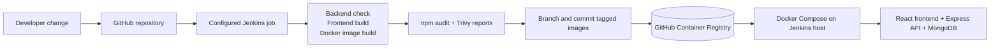

<div align="center">

# From Git Push to Running Containers

### A Jenkins CI/CD pipeline for a containerized MERN product-management application

[](https://www.jenkins.io/)
[](https://www.docker.com/)
[](https://ghcr.io/)
[](https://www.mongodb.com/)

</div>

---

## Project overview

This repository pairs a React storefront and product-management interface with a Jenkins delivery pipeline. Jenkins checks the application, builds and scans Docker images, publishes versioned images to GitHub Container Registry (GHCR), and deploys the Compose stack on the Jenkins host.

The deployment path is defined in [`Jenkinsfile`](Jenkinsfile). The GitHub Actions CI, CD, and security workflow files have been removed; Jenkins is the repository's CI/CD implementation. GitHub Dependabot configuration remains for dependency update pull requests.

## Jenkins delivery flow



The Jenkinsfile declares no webhook or polling trigger; configure automatic job triggers in Jenkins, outside this repository. Jenkins runs its CI and Docker build checks on the checked-out branch. Its security, image-publish, and deployment stages are limited to `main`, `staging`, and `qa`.

Although those three branches receive separate image tags, the current deploy stage uses the same deployment directory and Docker Compose project for all of them. They are not isolated QA, staging, and production deployments.

### Pipeline stages

1. Check out the triggering commit.
2. Run the backend `npm test` script and build the frontend with Vite. The current backend script runs `node --check src/server.js`; it is a syntax check, not an application test suite.
3. Build the backend and frontend Docker images for verification.
4. Run `npm audit` and Trivy scans for the `main`, `staging`, and `qa` branches. These findings are informational: the commands are configured not to fail the pipeline for reported vulnerabilities.
5. For `main`, `staging`, and `qa`, publish images tagged `<branch>-<short-commit>` and `<branch>-latest` to GHCR.
6. On the same branches, pull those images and run `docker compose up -d` on the Jenkins host using [`docker-compose.deploy.yml`](docker-compose.deploy.yml).

The deployment stage prints container information but does not perform an HTTP health check against the deployed site.

## Deployment evidence

The Jenkins stage-view screenshot shows a successful run with checkout, backend and frontend checks, Docker verification, security reporting, GHCR publishing, and deployment stages.


The application screenshot shows the product-management interface open in a browser.


## Application

- React 18 and Vite frontend with product listing, search, category filtering, and product add, edit, and delete actions.
- Node.js 20 and Express API with product CRUD endpoints and `GET /api/health`.
- MongoDB persistence through Mongoose.
- Production frontend served by Nginx, which serves the single-page app and proxies `/api` requests to the backend.

The repository also contains authentication, cart, and order modules, but they are not mounted in the current Express app or frontend router. The implemented application flow is product management.

## Technology

| Area | Tools |
|---|---|
| CI/CD | Jenkins Declarative Pipeline |
| Containers | Docker, Docker Compose |
| Registry | GitHub Container Registry (GHCR) |
| Frontend | React 18, Vite, Nginx |
| API | Node.js 20, Express 4 |
| Database | MongoDB, Mongoose |
| Security reporting | `npm audit`, Trivy |

## Run locally

### With Docker Compose

Requirements: Docker Engine and the Docker Compose plugin.

```bash
docker compose up -d --build
```

Open `http://localhost:5173`. The local stack starts the frontend, backend, and MongoDB; MongoDB data is stored in the `mongo-data` volume.

### Run the services separately

Requires Node.js 20 or later and a local MongoDB instance.

```bash
# Backend
cd backend
npm ci
npm run dev
```

In another terminal:

```bash
# Frontend
cd frontend
npm ci
npm run dev
```

## Jenkins controller

[`docker-compose.jenkins.yml`](docker-compose.jenkins.yml) and [`Dockerfile.jenkins`](Dockerfile.jenkins) define an optional isolated Jenkins controller with a persistent `jenkins_home` volume, a default host port of `8081`, and a one CPU / 2 GB memory limit. The setup guide describes this isolated controller; it is separate from any existing Jenkins instance used to run the pipeline.

The controller mounts the host Docker socket so trusted pipeline jobs can build and deploy images. Docker socket access gives jobs broad control of the host, so restrict access to trusted pipeline code.

See the [isolated Jenkins setup guide](docs/JENKINS_ISOLATED_SETUP.md) and [Jenkins pipeline guide](docs/CI_CD_GUIDE.md).

## Repository map

```text
backend/                   Express API and MongoDB integration
frontend/                  React application, Vite build, and Nginx config
docs/                      Jenkins setup and pipeline guides
.github/dependabot.yml     Dependency update configuration
Jenkinsfile                Jenkins CI, security reporting, publish, and deploy stages
docker-compose.yml         Local development stack
docker-compose.deploy.yml  Image-based deployment stack
docker-compose.jenkins.yml Optional isolated Jenkins controller
```

## Potential next improvements

- Add application-level automated tests and make them a deployment gate.
- Pin container base images and scanner/action dependencies to reviewed versions or digests.
- Make vulnerability thresholds configurable and fail builds for selected findings.
- Add a real post-deployment HTTP health check and rollback procedure.
- Use a dedicated build agent or remote builder instead of mounting the Jenkins host Docker socket.
